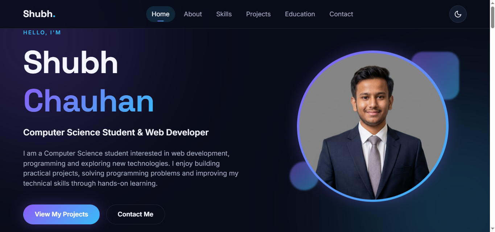

# Shubh Chauhan - Personal Portfolio

A personal portfolio website about my background, skills, projects, and contact information.

## Live Portfolio

Visit my portfolio: https://shubhchauhan.netlify.app/

## Technologies

- HTML5
- CSS3
- JavaScript (vanilla; no JavaScript libraries)
- Vite 5 for local development and production builds
- Google Fonts: Inter and Space Grotesk

## Projects

- **EduRo** - Educational institution management system.
- **Local Connect** - Platform connecting local job seekers with small businesses.

## Project structure

```text
project/
|-- IMG/
|   |-- P IMAGE.jpeg
|   |-- local-connect.png
|   `-- project/
|       |-- WhatsApp Image 2026-11-17 at 2.47.04 AM.jpeg
|       `-- image.png
|-- screenshots/
|   `-- portfolio-home.png
|-- .gitignore
|-- index.html
|-- package-lock.json
|-- package.json
|-- README.md
|-- script.js
`-- style.css
```

`node_modules/` and `dist/` are generated folders and are excluded from Git.

## Run locally

Install [Node.js](https://nodejs.org/) and npm, then run these commands from the project folder:

```sh
npm install
npm run dev
```

Vite prints a local URL to open in your browser.

## Production build

```sh
npm run build
```

Vite creates the production files in the `dist/` folder.

## Portfolio Screenshot


